## Project Overview

- Analyzed hospital patient data

- Created visualizations

- Built Decision Tree & KNN Models

## Dataset Description

Variables Used:

- Age

- Sex

- Race/Ethnicity

- Provider

- Admission Type

- Campus

- Length of Stay (LOS)

- Total Charges (TOT)

## Admissions by Sex

::::: columns
::: {.column width="40%"}
- Females represented a larger population

- This could be helpful to know for resources needed
:::

::: {.column width="60%"}
```{r}
#| echo: false
#| fig-width: 6
#| fig-height: 4.5
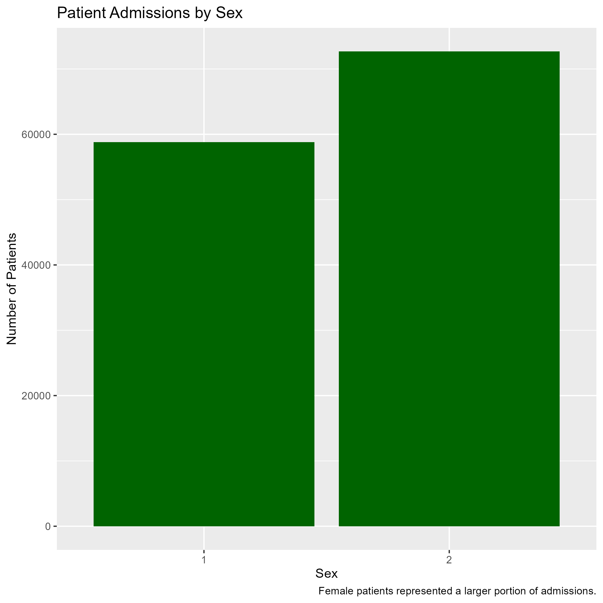
```
:::
:::::

## Patient Age Distribution

::::: columns
::: {.column width="40%"}
- Most patients were young children

- Large concentration of ages of 0-5

- Age distribution is not uniform across patients
:::

::: {.column width="60%"}
```{r}
#| echo: false
#| fig-width: 6
#| fig-height: 4.5
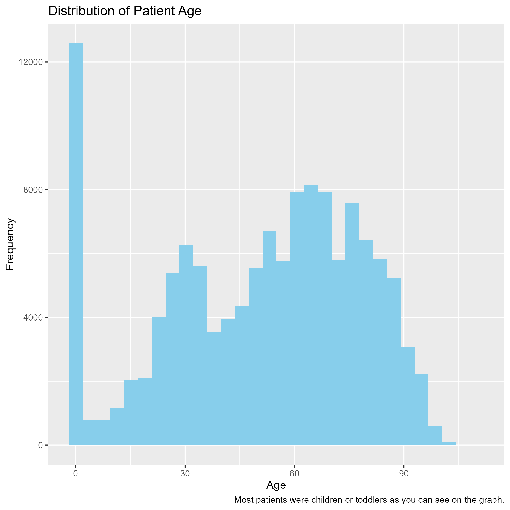
```
:::
:::::

## Admissions by Month

::: columns
- May and October had the highest admissions

- February showed the lowest number of admissions (shortest month)
:::

:::: columns
::: {.column width="70%"}
```{r}
#| echo: false
#| fig-width: 6
#| fig-height: 4.5
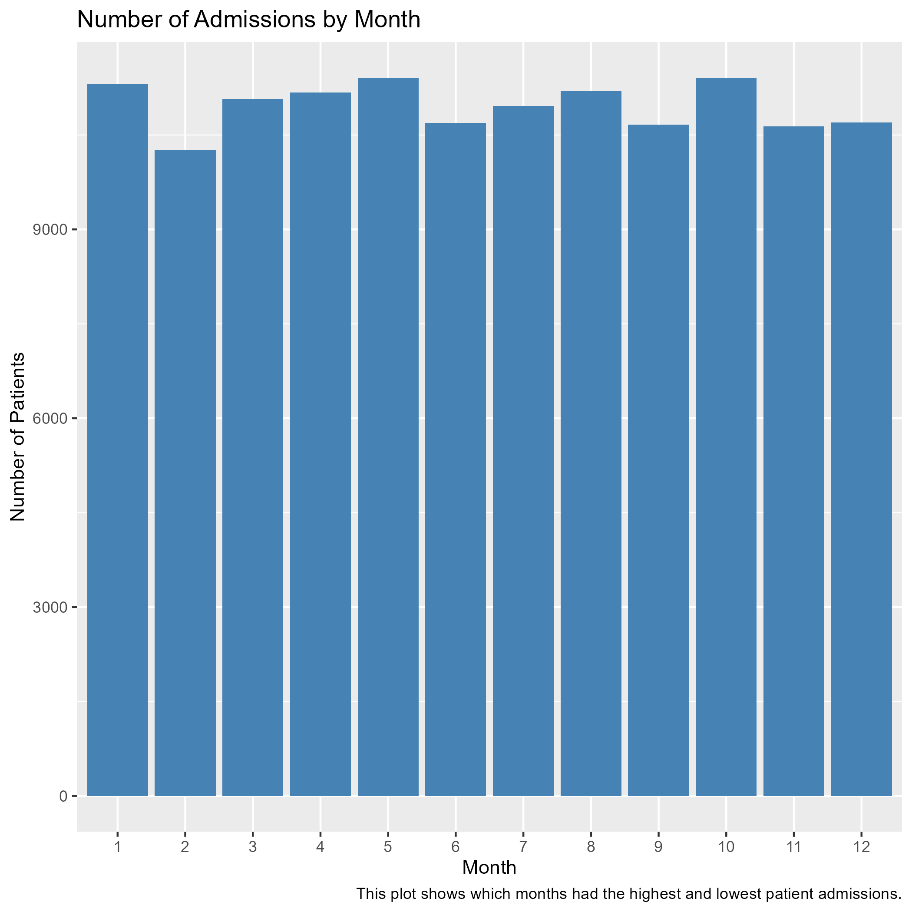
```
:::
::::

## Patient Age Distribution by Month

::: columns
- These patterns remain pretty consistent throughout the year

- Actually interesting considering the winter months
:::

:::: columns
::: {.column width="70%"}
```{r}
#| echo: false
#| fig-width: 6
#| fig-height: 4.5
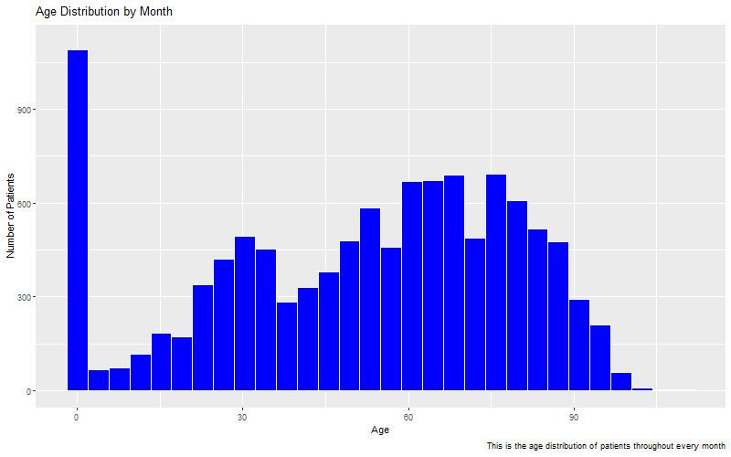
```
:::
::::

## Age Distribution by Sex

::: {.columns width="40%"}
- Most patients were age 0 or between 55-85

- Females were more represented at ages 20-35
:::

:::: columns
::: {.column width="60%"}
```{r}
#| echo: false
#| fig-width: 6
#| fig-height: 4.5
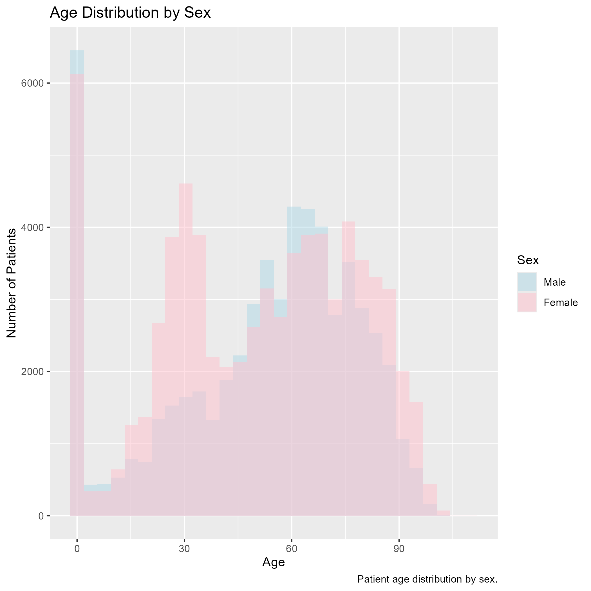
```
:::
::::

## Top 10 Providers by Number of Patients

::: {.columns width="40%"}
- Provider 7205 (Bradley) had the most patients by a substantial margin
:::

:::: columns
::: {.column width="60%"}
```{r}
#| echo: false
#| fig-width: 6
#| fig-height: 4.5
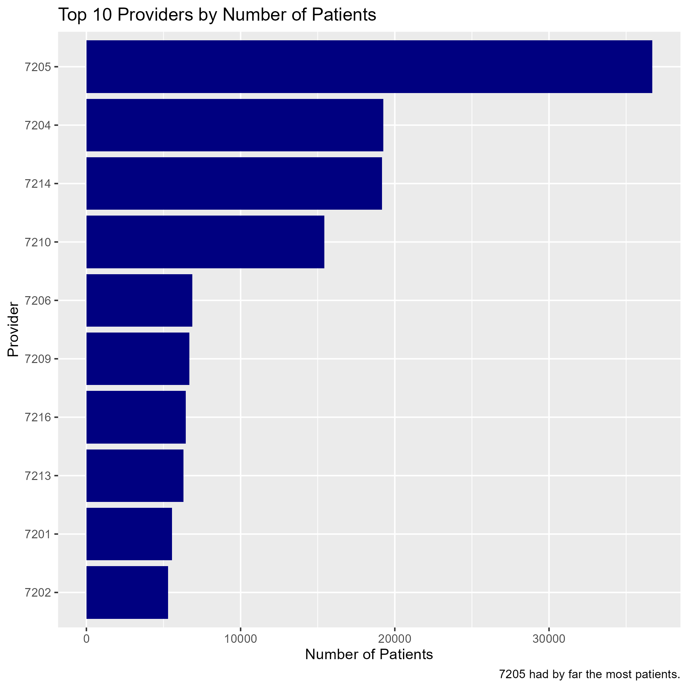
```
:::
::::

## Average Total Charges by Month

::: {.columns width="40%"}
- Average hospital charges were relatively the same throughout the year
- July had the smallest total charge
:::

:::: columns
::: {.column width="60%"}
```{r}
#| echo: false
#| fig-width: 6
#| fig-height: 4.5
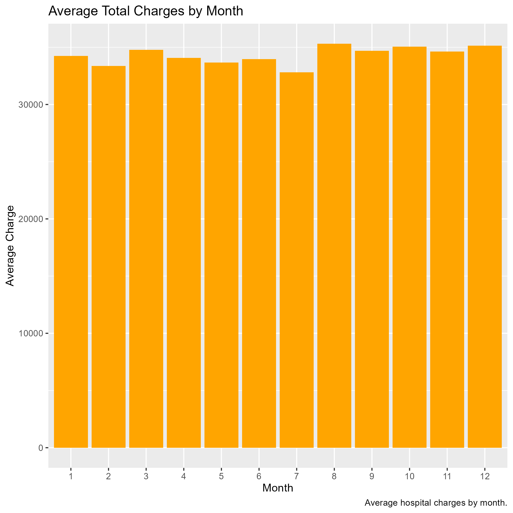
```
:::
::::

## Total Charges by Sex

::: {.columns width="40%"}
- Both groups contain a large number of high-cost outliers
- Most patients had relatively low charges, there were some extremes
:::

:::: columns
::: {.column width="60%"}
```{r}
#| echo: false
#| fig-width: 6
#| fig-height: 4.5
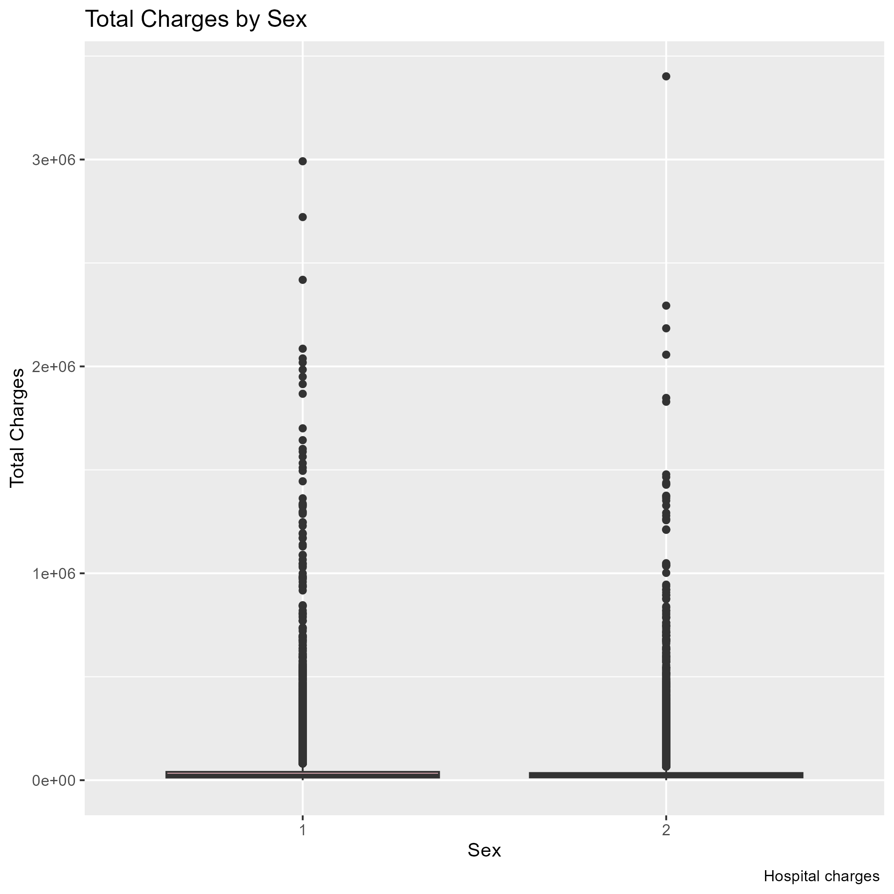
```
:::
::::

## Total Charges by Length of Stay

::: {.columns width="40%"}
- Positive relationship between LOS and total charges
:::

:::: columns
::: {.column width="60%"}
```{r}
#| echo: false
#| fig-width: 6
#| fig-height: 4.5
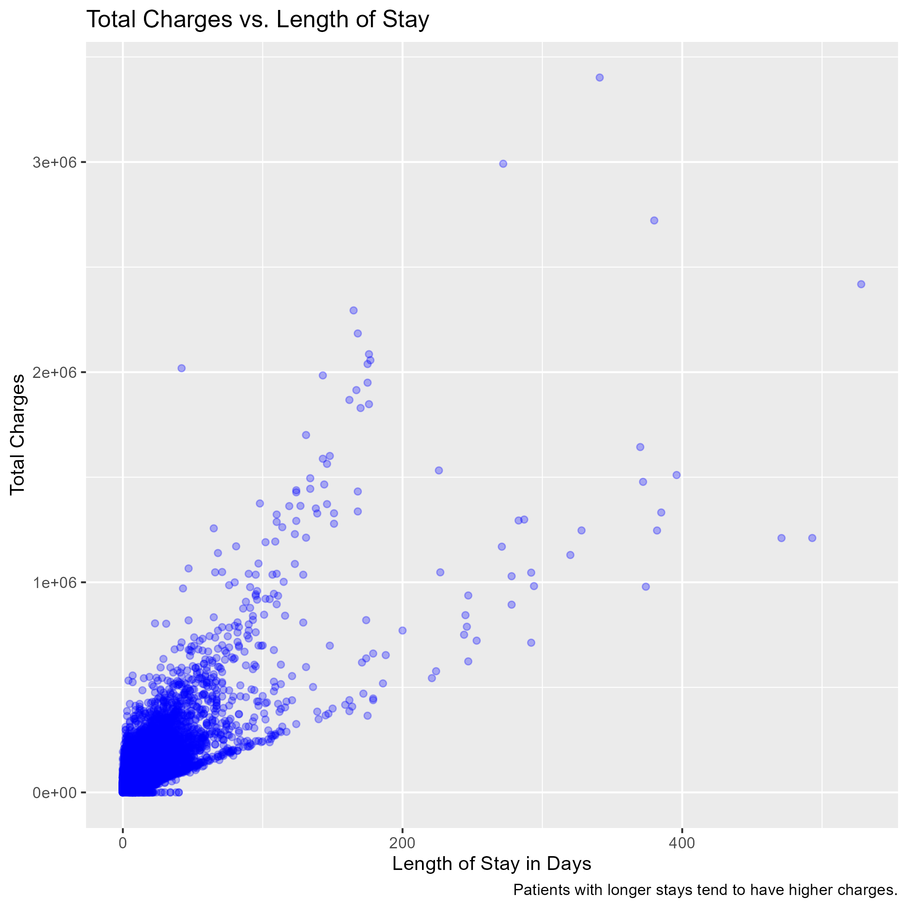
```
:::
::::

## Charges by Season

::: {.columns width="40%"}
- Median total charges were similar meaning healthcare costs remained pretty consistent
:::

:::: columns
::: {.column width="60%"}
```{r}
#| echo: false
#| fig-width: 6
#| fig-height: 4.5
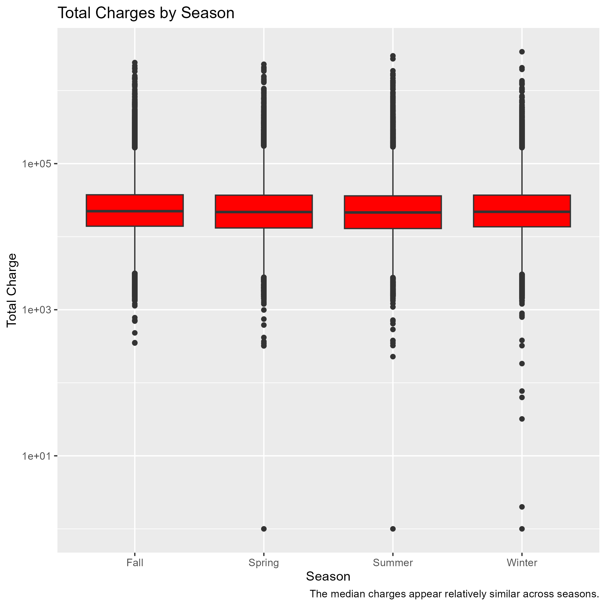
```
:::
::::

## Length of Stay by Season

::: {.columns width="40%"}
- Typical length of stay was similar across all season
- The most extreme outliers were in the Fall, and least in the Spring
:::

:::: columns
::: {.column width="60%"}
```{r}
#| echo: false
#| fig-width: 6
#| fig-height: 4.5
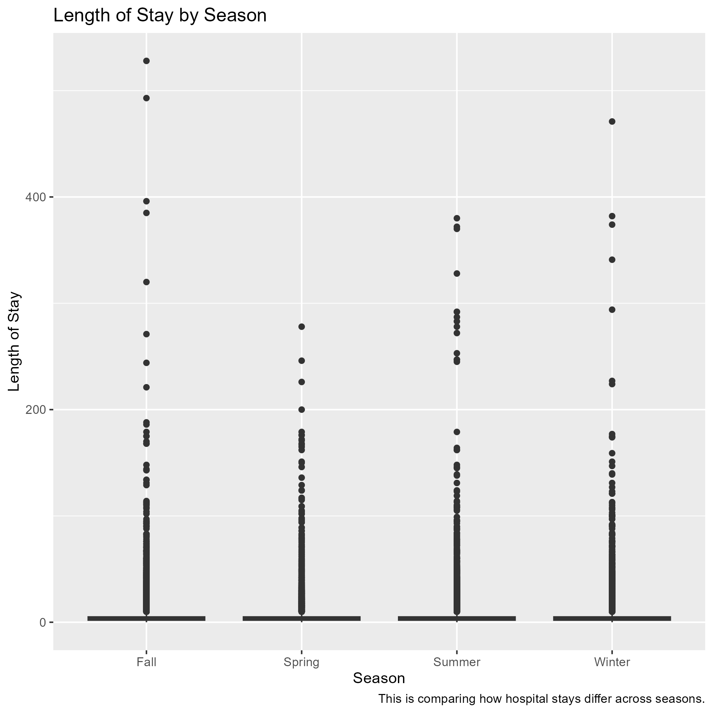
```
:::
::::

## Comparison Model

```{r, echo=FALSE, out.width="100%"}
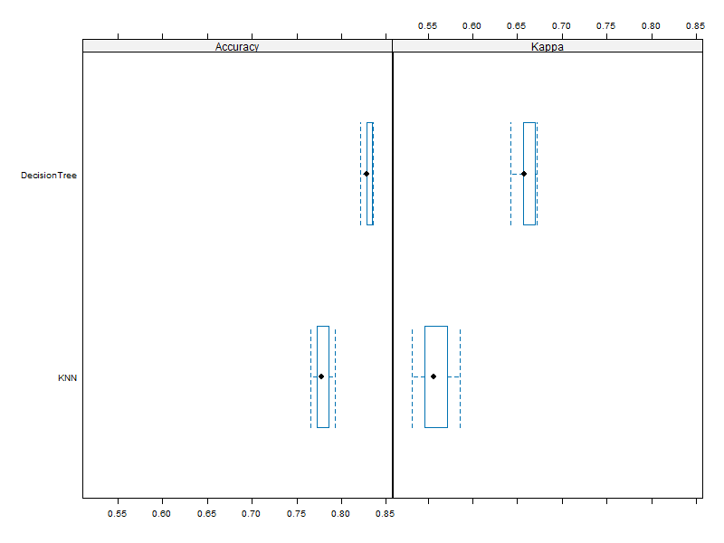

```

This is the Comparison model for question 4

## Model Training & Comparison

Models Evaluated:

- Decision Tree & K-Nearest Neighbors (KNN)

Results:

- Decision Tree Accuracy: 81%

- KNN Accuracy: 77%

The Decision Tree achieved the highest accuracy and was selected as the best model.

## Question 6

::: {.columns width="40%"}
- Decision Tree Accuracy: 78.96%
- KNN Accuracy: 72.64%
- The Decision Tree was selected as the final model
- Compared the patient's length of stay was above or below the median
:::

:::: columns
::: {.column width="60%"}
```{r}
#| echo: false
#| fig-width: 6
#| fig-height: 4.5
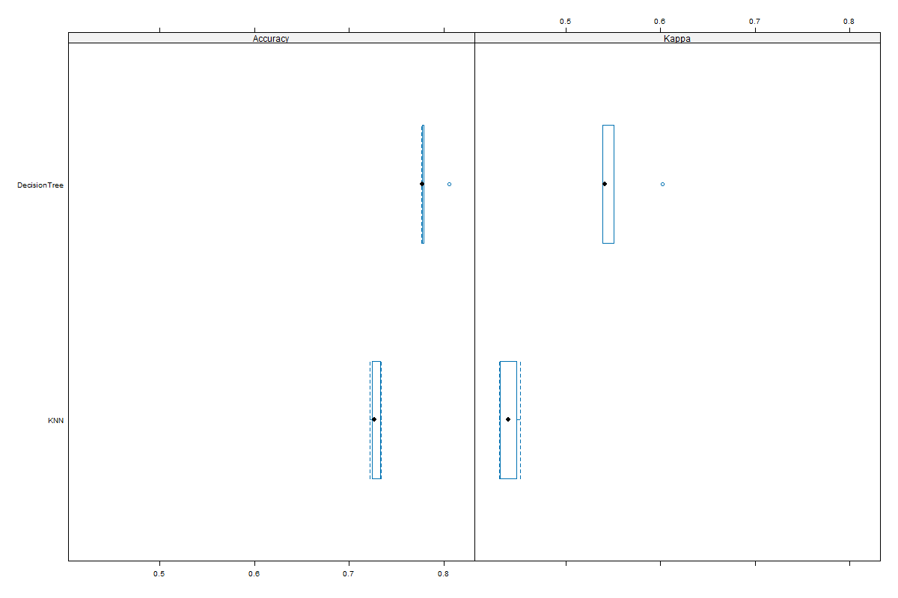
```
:::
::::

## Challenges

- Data took a long time to load

- Trying to fit the graphs onto the slides with the wording
